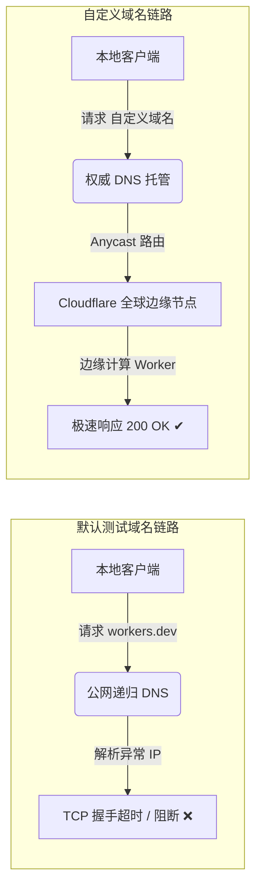
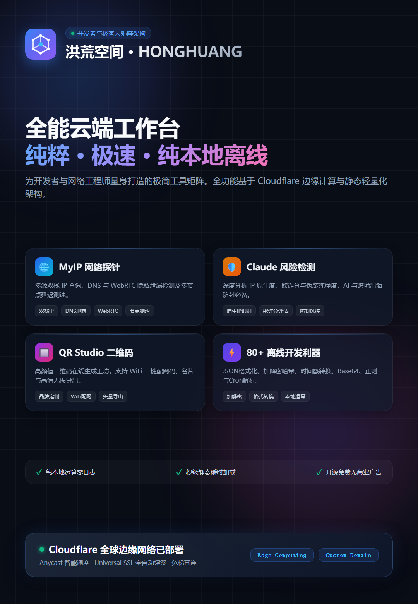

@[TOC](文章目录)

---

# Cloudflare Workers 默认域名打不开？手把手教你绑定自定义域名（实战图文指南）

> **方向**：云原生架构 / 边缘计算 / 网络运维  
> **环境要求**：Cloudflare 账号、已托管的域名、已创建的 Worker 服务

---

## 前言：为什么刚部署好的 Worker 频繁超时？

在使用 **Cloudflare Workers** 构建轻量化 Serverless 边缘应用（如 IP 诊断探针、环境风险检测、API 代理或轻量静态页面）时，很多开发者都会遇到相同的问题：

在控制台完成代码构建并部署后，点击系统自动分配的默认测试域名：
`https://<项目名>.<账户子域>.workers.dev`

浏览器往往会陷入长时间等待，随后抛出常见错误：
- `连接已超时`
- `无法访问此网站`
- `ERR_CONNECTION_TIMED_OUT`

这并不是 Worker 边缘逻辑报错，也不是代码存在语法异常，而是由于底层的网络访问链路受到了限制。

本文将深入分析这一现象的技术根因，并给出标准的**自定义域名（Custom Domains）绑定全流程与踩坑排查指南**。

---

## 一、技术原理解析：workers.dev 不可达的根本原因

Cloudflare 为每个免费账户提供的默认公网测试域格式均为 `*.workers.dev`。

在中国大陆网络环境下，该根域名长期存在以下网络限制：
1. **DNS 劫持与污染**：公网递归 DNS 在解析 `*.workers.dev` 时，会被解析至不可达的境外保留或异常 IP；
2. **SNI 握手拦截**：即使客户端通过指定 Hosts 直连到合规的 Cloudflare Anycast 节点，在 TLS 建立握手传输 Client Hello 时，包含该域名的 SNI 字段也会被识别阻断。

### 解决方案：接入自定义域名（Custom Domains）

Cloudflare 官方提供了原生自定义域名支持：**将 Worker 路由挂载至开发者自有的二级域名（例如 `api.yourdomain.com`）**。

其底层优势包括：
- **独立权威解析**：使用自己的域名进行解析，避开测试根域名的阻断；
- **全自动 Universal SSL**：Cloudflare 自动完成证书申领、部署及轮换续期；
- **Anycast 边缘智能调度**：直接复用 Cloudflare 全球边缘数据中心网络，国内网络无需复杂配置即可直接连通。

---

## 二、前置条件检查

在配置之前，请确认具备以下条件：
1. **已部署的 Worker 项目**（例如 `claude-ip-check` 或其他边缘计算函数）；
2. **一个自有域名**（例如 `yourdomain.com`），且该域名的 **Nameservers 权威 DNS 已托管在当前的 Cloudflare 账号中**。

---

## 三、实战操作流程（5 步配置）

### 步骤 1：定位目标 Worker 服务

1. 登录 Cloudflare 官方控制台（`dash.cloudflare.com`）；
2. 在左侧控制面板中点击 **Workers & Pages**；
3. 在服务列表中找到需要绑定的项目名称，点击进入详情配置页面。

  
  
<i>图 1：在服务列表中进入 Worker 管理页</i>

---

### 步骤 2：进入「域和路由」配置面板

1. 在项目概览顶部横向导航栏中，点击右侧的 **Settings (设置)** 选项卡；
2. 在展开的左侧子菜单中，选择 **Domains & Routes (域和路由)**。

  
  
<i>图 2：进入 Domains & Routes 配置界面</i>

---

### 步骤 3：发起自定义域名添加

1. 向下滚动页面，找到 **Custom Domains（自定义域）** 模块；
2. 点击模块右上角的蓝色 **`Add (添加)`** 按钮；
3. 在下拉选项中点击 **`Custom domain`**。

  
  
<i>图 3：选择添加 Custom domain</i>

---

### 步骤 4：填写规划的二级域名

1. 在弹出的输入框中，输入规划好的子域名（例如：`ipcheck.yourdomain.com`）；
2. 点击右下角 **`Add Custom Domain`** 提交保存。

  
  
<i>图 4：输入分配的二级域名并确认保存</i>

> **系统后台自动执行的操作**：  
> Cloudflare 将在对应域名的 DNS 区域中自动创建指向该 Worker 的 CNAME 记录，自动启用代理网络，并同时向证书颁发机构申请专属 SSL 证书，无需手动编辑 DNS 表。

---

### 步骤 5：等待全球广播与证书签发

1. 提交后回到列表，新绑定的域名初始状态通常为 `Initializing (初始化中)`；
2. 保持网络畅通，等待 1 至 3 分钟后刷新页面；
3. 当看到状态指示变更为绿色的 **`● Active (有效)`** 时，说明配置已经就绪。

  
  
<i>图 5：域名状态变更为 Active</i>

此时即可直接在本地浏览器访问配置的域名：`https://ipcheck.yourdomain.com`，服务已处于畅通访问状态。

---

## 四、常见问题排查与避坑指南 (FAQ)

### 1. 状态长时间停留在 `Initializing`？
- **检查同名记录冲突**：前往该域名的 DNS 管理页，检查是否存在之前手动配置的同名 A 记录或 CNAME 解析。若有残留记录，需先手动删除后再重新添加 Custom Domain；
- **检查 SSL 加密模式**：主域名的「SSL/TLS」全局设置需保持为 **Full** 或 **Full (strict)**，避免选择 Off 或 Flexible 导致握手循环。

### 2. 绑定自定义域名后原有的测试域名是否有效？
- 通过控制台添加自定义域名，默认与原有的 `workers.dev` 属于双轨并行状态；
- 若后续使用 Wrangler 本地脚手架自动化部署，可在配置文件中显式保留 `workers_dev = true`。

### 3. 支持绑定裸域（根域名）或多域名吗？
- 完全支持。一个 Worker 允许挂载多个独立的二级域名甚至主根域名，只需重复上述添加流程即可。

---

## 五、技术案例：基于边缘计算的工具矩阵架构

在实际生产场景中，以极客工具矩阵项目 **「洪荒空间 (amw3.eu.org)」** 为例，系统便是依托 Cloudflare Workers 边缘计算节点构建了全套轻量级诊断矩阵：

  
  
<i>图 6：多云边缘矩阵整体服务架构图</i>

### 核心架构模块划分：
- **IP 网络探针 (MyIP)**：采用多源双栈探测机制，实现 WebRTC/DNS 泄漏诊断及边缘延迟测速；
- **AI 访问风控检测 (Claude Risk Check)**：实时评估出口 IP 原生属性与欺诈分，输出环境纯净度评级；
- **离线开发者实用工具集**：包含加解密、JSON、时间戳等 80+ 常用模块，全部在客户端本地浏览器中执行，保障核心数据零网络上传；
- **QR Studio 渲染引擎**：基于本地 Canvas 提供离线矢量二维码生成与样式定制能力。

---

## 六、总结

通过合理利用 Cloudflare 的 Custom Domains 机制，开发者能够以零服务器成本的方式，将边缘函数与服务安全、高效地投产到公网环境。此方案架构轻量、运维成本低，是现代 Serverless 边缘应用落地的通用实践方案。
